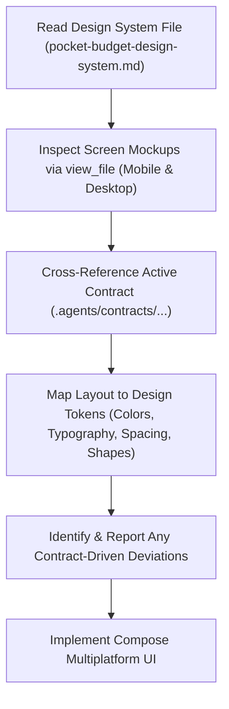

# Pocket Budget Design System & Visual Reference Guide

This skill governs the implementation of Compose Multiplatform screens in Pocket Budget. Whenever working on UI, agents must use the **formal design system specification** alongside the **mobile and desktop screen mockups** to build accessible, visually faithful, and consistent screens.

---

## 1. Required Design Reference Sources

Every UI implementation must combine two complementary sources located in `docs/design/reference/`:

### A. Design System Specification (`pocket-budget-design-system.md`)
- **File**: [`docs/design/reference/pocket-budget-design-system.md`](file:///Users/apple/Documents/Agentic%20Engineering/budget-poket%20resources/pocket-budget/docs/design/reference/pocket-budget-design-system.md)
- **Role**: Single source of truth for **tokens**:
  - Exact hex color values and Material Design 3 semantic color roles.
  - Typography scale (Work Sans, font sizes, line heights, letter spacings, weights).
  - Shape radiuses (cards, inputs, pills, buttons).
  - Spacing scale (8pt grid, container margins, touch targets).
  - Elevation levels and shadow parameters.
  - Component dimension specifications (e.g. 72px list items, 48px touch targets, 40px icon avatars).

### B. Visual Screen Mockups (`pocket-budget-mobile-design/` & `pocket-budget-desktop-design/`)
- **Mobile References** (`docs/design/reference/pocket-budget-mobile-design/`):
  - `add-expense.png`, `add-income.png`, `budget-transaction-listing.png`, `budget-listing.png`, `set-budget.png`
- **Desktop References** (`docs/design/reference/pocket-budget-desktop-design/`):
  - `add-transaction.png`, `dashboard-transaction.png`, `budget-progress.png`, `set-budget.png`
- **Role**: Single source of truth for **visual composition**:
  - Screen layouts, padding, card arrangements, and header alignments.
  - Interactive states (segmented toggle states, focus indicators, button variants).
  - Responsive differences between handheld portrait mobile and widescreen desktop layouts.

---

## 2. UI Development Workflow

Whenever tasked with building or modifying UI screens:

1. **Read Design Tokens**: View [`pocket-budget-design-system.md`](file:///Users/apple/Documents/Agentic%20Engineering/budget-poket%20resources/pocket-budget/docs/design/reference/pocket-budget-design-system.md) to extract exact colors, typography styles, spacing, and radius tokens for the target screen.
2. **Inspect Mockup Images**: Call `view_file` on the corresponding mobile and desktop PNG files to inspect structural layout, visual hierarchy, and element relationships.
3. **Cross-Reference Contract**: Check the active implementation contract (e.g., `.agents/contracts/add-and-keep-transaction.md`) to verify which visual elements are in-scope and which are explicitly excluded.
4. **Map to Compose Tokens**: Translate the formal tokens directly into Compose primitives (`Color(0xFF...)`, `TextStyle(...)`, `RoundedCornerShape(...)`, `Modifier.padding(...)`).
5. **Report Deviations**: Explicitly document intentional contract-driven deviations in the implementation plan and walkthrough.

---

## 3. Pocket Budget Design Tokens Summary

*(Extracted from [`pocket-budget-design-system.md`](file:///Users/apple/Documents/Agentic%20Engineering/budget-poket%20resources/pocket-budget/docs/design/reference/pocket-budget-design-system.md))*

### A. Color Palette

Token Name | Hex Value | Semantic Role & UI Usage
:--- | :--- | :---
`primary` | `#005136` | Forest Green: Primary action buttons, active tab indicators, brand headers.
`on-primary` | `#FFFFFF` | Text/icons on primary surfaces.
`primary-container` | `#006c49` | High-emphasis container fills, focused accent states.
`on-primary-container` | `#93eabe` | Contrast text/icons on primary container.
`surface` / `background` | `#eefdf2` | Tinted Light Slate/Mint background (reduces glare).
`surface-container-lowest` | `#FFFFFF` | Pure White: Interactive cards, list containers, bottom sheets.
`surface-container` | `#e3f2e7` | Soft Container: Input field fills, inactive toggle backgrounds.
`surface-container-high` | `#ddece1` | Elevated container backgrounds, subtle section dividers.
`on-surface` | `#121e18` | Dark Navy/Charcoal: Primary text, bold headers, prominent amounts.
`on-surface-variant` | `#3f4943` | Slate Gray: Subtitles, date captions, placeholder text, secondary icons.
`outline` | `#6f7a72` | Card/input borders.
`outline-variant` | `#bec9c0` | Subtle hairline dividers (10% opacity).
**Income / Positive** | `#059669` | Income text (`+$X.XX`), income badges, positive cashflow.
**Expense / Error** | `#BA1A1A` | Expense text (`-$X.XX`), error indicators, negative cashflow.
**Near-Limit / Warning** | `#F59E0B` | Amber budget threshold warnings.

### B. Typography Scale (Work Sans)

Style | Size / Weight | Line Height | Tracking | Usage
:--- | :--- | :--- | :--- | :---
`display-lg` | `32.sp`, Bold (`700`) | `40.sp` | `-0.02em` | Large hero balance display (scales to `28.sp` if constrained).
`headline-md` | `24.sp`, Semi-Bold (`600`) | `32.sp` | `-0.01em` | Primary screen headers ("Transactions", "New Transaction").
`headline-sm` | `20.sp`, Semi-Bold (`600`) | `28.sp` | Normal | Card section titles ("Cashflow Overview", "Recent Transactions").
`numeric-xl` | `28.sp`, Semi-Bold (`600`) | `34.sp` | `-0.02em` | Metric cards and prominent transaction amounts.
`body-lg` | `16.sp`, Regular (`400`) | `24.sp` | Normal | Primary list titles, input text, prominent button labels.
`body-md` | `14.sp`, Regular (`400`) | `20.sp` | Normal | Subtitle descriptions, secondary details, table rows.
`label-md` | `12.sp`, Medium (`500`) | `16.sp` | `0.05em` | Uppercase section badges ("CATEGORY", "TODAY, AUG 22").

### C. Shapes & Radii

Token | Value | Compose Shape | Usage
:--- | :--- | :--- | :---
`rounded-sm` | `4.dp` | `RoundedCornerShape(4.dp)` | Small indicator bars.
`rounded-DEFAULT` | `8.dp` | `RoundedCornerShape(8.dp)` | Progress bar tracks and indicator fills.
`rounded-md` | `12.dp` | `RoundedCornerShape(12.dp)` | Category icon badges.
`rounded-lg` | `16.dp` | `RoundedCornerShape(16.dp)` | **Standard cards, bottom sheets, text input fields.**
`rounded-xl` | `24.dp` | `RoundedCornerShape(24.dp)` | Large desktop surface panels.
`rounded-full` | `9999.dp` | `CircleShape` / Capsule | **Primary buttons, segmented toggles, filter chips, FAB.**

### D. Spacing & Dimensions (8pt Grid)

Token | Value | Usage
:--- | :--- | :---
`spacing-xs` | `4.dp` | Tight inline icon-to-text spacing.
`spacing-sm` | `8.dp` | Spacing between closely grouped elements (title/subtitle).
`spacing-md` | `16.dp` | Standard outer container margin, internal card padding, element gap.
`spacing-lg` | `24.dp` | Gap between distinct sections or form groups.
`spacing-xl` | `32.dp` | Major structural spacing between header and content cards.
**Touch Target** | `>= 48.dp` | Minimum height for buttons, list items, and interactive chips.
**List Item Height**| `72.dp` | Standard transaction row height with `40.dp` leading avatar/badge.

### E. Elevation & Shadows

Level | Value | Usage
:--- | :--- | :---
**Level 0** | Flat (`0.dp`) | Tinted screen background (`#eefdf2`).
**Level 1** | Soft Shadow (`0px 4px 12px rgba(19, 27, 46, 0.05)`) | Pure White cards and form containers.
**Level 2** | Floating (`0px 8px 24px rgba(19, 27, 46, 0.08)`) | Bottom navigation bar, floating action buttons (FAB), dialogs.

---

## 4. Reconciling Tokens & Mockups with Contract Boundaries

Mockups frequently illustrate features planned for subsequent phases. Always adhere to these reconciliation rules:

1. **Contract Overrides Mockup Scope**:
   - If an element appears in `add-expense.png` (such as the Category selector grid or Date picker) but is excluded by the contract (Section 3 of `add-and-keep-transaction.md`), **do not build the feature or data model**.
2. **Design Tokens Apply to In-Scope Elements**:
   - When building the contract-compliant version of the form (e.g. amount, description, and income/expense toggle), style those elements using the exact tokens from [`pocket-budget-design-system.md`](file:///Users/apple/Documents/Agentic%20Engineering/budget-poket%20resources/pocket-budget/docs/design/reference/pocket-budget-design-system.md) and the layout hierarchy from the mockup.
3. **Transparent Reporting**:
   - In all implementation proposals, report intentional contract-driven deviations:
     - **Mockup Component**: What is visible in the reference image.
     - **Contract Constraint**: Reason for omission or simplification.
     - **Preserved Styling**: How the active components maintain the visual language of the design system.

---

## 5. Pre-Implementation Checklist

Before committing any UI code:

- [ ] Inspected [`pocket-budget-design-system.md`](file:///Users/apple/Documents/Agentic%20Engineering/budget-poket%20resources/pocket-budget/docs/design/reference/pocket-budget-design-system.md) for exact color hexes, typography specs, radiuses, and spacing.
- [ ] Viewed relevant mobile & desktop PNG mockups with `view_file` to observe screen layout and interactive states.
- [ ] Verified all inputs and actions match the active implementation contract.
- [ ] Ensured monetary amounts convert directly between text and `Long` integer cents (strictly no `Double` or `Float`).
- [ ] Documented any intentional deviations between mockups and the contract.
